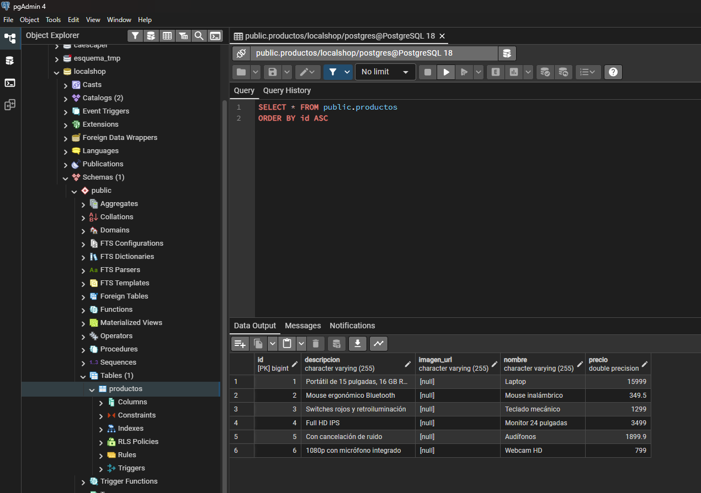
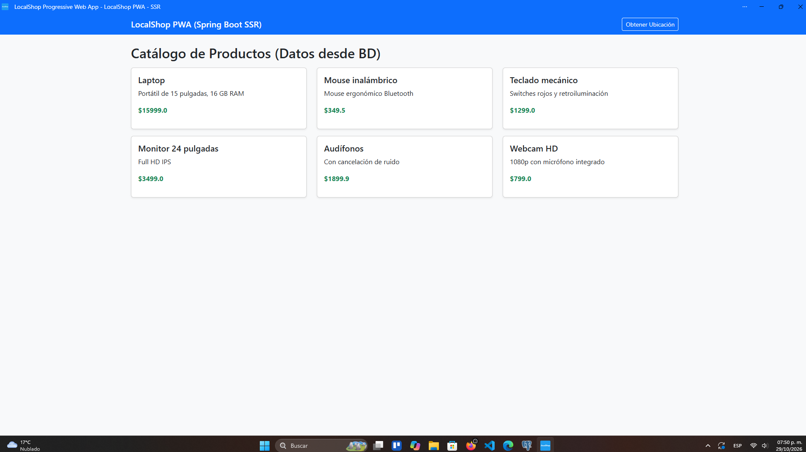
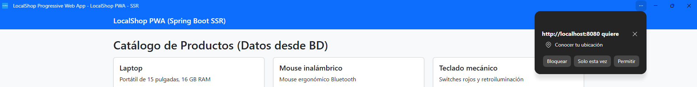
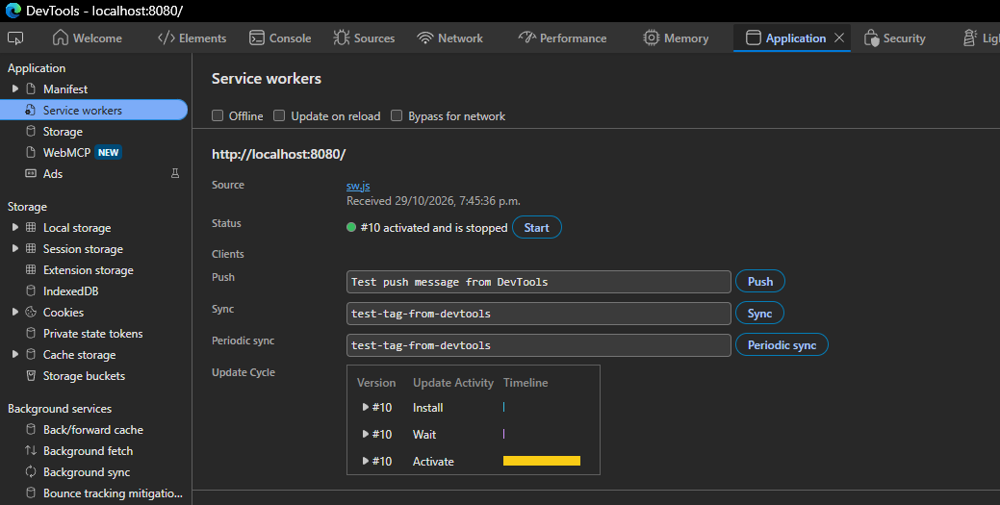
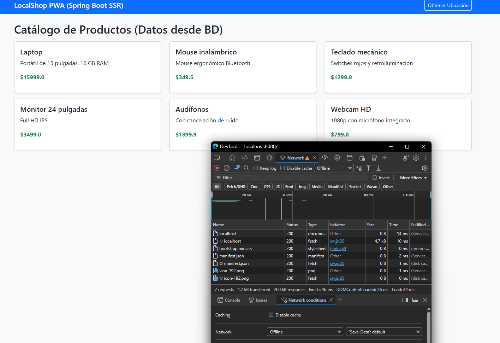

# LocalShop PWA – Práctica 4

Aplicación Web Progresiva (PWA) desarrollada como parte de la Práctica 4 de Desarrollo de Software Multiplataforma.

El proyecto consiste en desarrollar una aplicación web para visualizar un catálogo de productos, utilizando Java y Spring Boot para el manejo del servidor, Thymeleaf para el renderizado de páginas y una base de datos relacional para almacenar la información.

También se contemplan características de una Progressive Web App, como el uso de un manifiesto web, Service Worker, almacenamiento en caché y acceso a funciones nativas del dispositivo.

## Tecnologías utilizadas

- **Java 21:** Lenguaje de programación.
- **Spring Boot:** Framework para el desarrollo del backend.
- **Spring Web MVC:** Manejo de controladores y solicitudes HTTP.
- **Spring Data JPA:** Persistencia y comunicación con la base de datos.
- **Thymeleaf:** Renderizado de páginas HTML desde el servidor (SSR).
- **PostgreSQL:** Sistema de gestión de base de datos.
- **Lombok:** Reducción de código repetitivo en las clases Java.
- **Maven:** Administración de dependencias y construcción del proyecto.
- **JavaScript:** Registro del Service Worker y acceso a APIs del dispositivo.
- **Bootstrap:** Diseño y adaptación de la interfaz.

## Objetivo de la práctica

Desarrollar e integrar una Aplicación Web Progresiva utilizando Java y Spring Boot, implementando una arquitectura MVC, persistencia de datos mediante Spring Data JPA y renderizado del lado del servidor con Thymeleaf.

Además, integrar los componentes necesarios para convertir la aplicación en una PWA, permitiendo el almacenamiento de recursos en caché, funcionamiento sin conexión y acceso a funciones del dispositivo como la geolocalización.

## Desarrollo de la práctica

### Etapa 1. Configuración de la base de datos y modelo (SSR Back-End)

En esta primera etapa se prepara la estructura del backend y la conexión con la base de datos.

Se trabajan los siguientes componentes:

- **Modelo Producto:** Representa la información de los productos y permite almacenarla mediante JPA.
- **Repositorio ProductoRepository:** Permite realizar operaciones de consulta y gestión de los productos.
- **Controlador ProductoController:** Se encarga de obtener los productos de la base de datos y enviarlos a la vista mediante Thymeleaf.
- **Configuración de base de datos:** Establece la conexión entre Spring Boot y PostgreSQL.

**Evidencias:**



*Figura 1. Configuración de la base de datos y almacenamiento de productos.*

### Etapa 2. Componentes PWA y App Shell SSR

En esta etapa se integran los elementos necesarios para que la aplicación pueda funcionar como una Progressive Web App.

Se consideran los siguientes componentes:

- **Manifest Web:** Contiene la información de la aplicación, como nombre, iconos, colores y modo de visualización.
- **Vista principal con Thymeleaf:** Presenta el catálogo de productos utilizando los datos enviados desde el servidor.
- **App Shell:** Proporciona la estructura principal de la aplicación.
- **Geolocalización:** Permite obtener las coordenadas del dispositivo mediante la API de Geolocation del navegador.

**Evidencias:**



*Figura 2. Interfaz principal y catálogo de productos.*



*Figura 3. Funcionamiento de la API de geolocalización.*

### Etapa 3. Service Worker y funcionamiento sin conexión

En esta última etapa se implementa el Service Worker, encargado de administrar las solicitudes de red y el almacenamiento de recursos en caché.

Esto permite que determinados recursos de la aplicación puedan seguir disponibles cuando el dispositivo pierde la conexión a Internet.

Se trabajan los siguientes aspectos:

- Registro del Service Worker desde la aplicación.
- Almacenamiento de recursos del App Shell en caché.
- Interceptación de solicitudes mediante el evento `fetch`.
- Recuperación de recursos almacenados cuando no existe conexión a Internet.

**Evidencias:**



*Figura 4. Registro del Service Worker en el navegador.*



*Figura 5. Comportamiento de la aplicación sin conexión a Internet.*

## Estructura del proyecto

El repositorio contiene el proyecto Spring Boot dentro de la carpeta `localshop`.

```text
Practica-4-pwa/
│
├── localshop/
│   ├── src/
│   │   └── main/
│   │       ├── java/
│   │       └── resources/
│   ├── pom.xml
│   └── ...
│
├── Evidencias/
│   └── (capturas de evidencias)
│
└── README.md
```

## Requisitos para ejecutar el proyecto

Antes de ejecutar la aplicación es necesario contar con:

- JDK 21 o superior.
- Maven.
- PostgreSQL.
- Git.
- Un navegador web actualizado (se recomienda Google Chrome).

## Instalación y ejecución local

**1. Clonar el repositorio**

```bash
git clone https://github.com/CrazyBread7364/Practica-4-pwa.git
```

**2. Entrar a la carpeta del proyecto**

```bash
cd Practica-4-pwa/localshop
```

**3. Configurar la base de datos**

Crear una base de datos en PostgreSQL con el nombre:

```sql
CREATE DATABASE localshop;
```

Configurar las credenciales de conexión en:

`src/main/resources/application.properties`

Ejemplo de configuración:

```properties
spring.application.name=localshop

spring.datasource.url=jdbc:postgresql://localhost:5432/localshop
spring.datasource.username=postgres
spring.datasource.password=TU_CONTRASEÑA

spring.jpa.hibernate.ddl-auto=update
spring.jpa.show-sql=true
```

Reemplazar las credenciales de ejemplo por las correspondientes al entorno local.

**4. Ejecutar la aplicación**

Desde la carpeta `localshop`, ejecutar:

```bash
mvn spring-boot:run
```

**5. Acceder a la aplicación**

Abrir el navegador y entrar a:

```text
http://localhost:8080
```

## Autores

Proyecto desarrollado en equipo como parte de la Práctica 4.

- **Angel David Arras Orozco**
- **Guillermo Martínez Delgadillo**
- **Jesus Arturo Castilla Gonzalez**
- **Angel Guillermo Gonzalez Gomez**
- **Víctor Hugo Baeza Rocha**
- **Dylan Muñoz Flores**


## Repositorio

[GitHub – Practica-4-pwa](https://github.com/CrazyBread7364/Practica-4-pwa)
